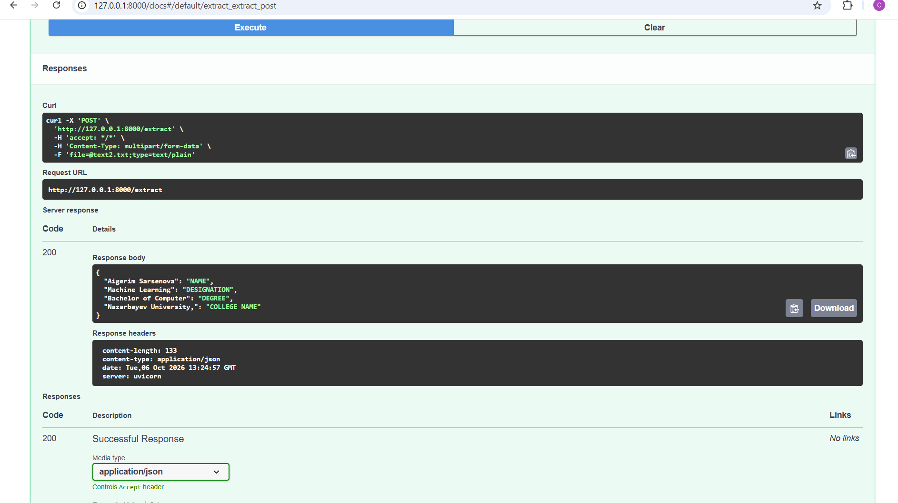

# Resume NER — XLM-RoBERTa + FastAPI

Named Entity Recognition (NER) system for extracting structured information from resumes.

The project uses a fine-tuned XLM-RoBERTa model for token classification and provides a FastAPI inference service for extracting entities from `.txt` resume files.

## Features

- Fine-tuned XLM-RoBERTa for resume NER
- 23 BIO labels
- Subword-to-word prediction aggregation
- Entity extraction using token probability scores
- BIO tag post-processing
- Support for long texts through token-based chunking with overlap
- FastAPI inference API
- UTF-8 `.txt` file validation
- Automatic model loading from a local checkpoint

## Entity Types

The model recognizes the following entity types:

- COLLEGE NAME
- COMPANIES WORKED AT
- DEGREE
- DESIGNATION
- EMAIL ADDRESS
- GRADUATION YEAR
- LOCATION
- NAME
- SKILLS
- UNKNOWN
- YEARS OF EXPERIENCE

## Project Structure

```text
resume-ner/
├── app/
│   ├── __init__.py
│   ├── main.py
│   ├── inference.py
│   └── postprocessing.py
├── models/
│   └── xlm_roberta_ner/
├── notebooks/
│   └── NER_training.ipynb
├── requirements.txt
└── README.md
``` 
## Training

The model was fine-tuned for resume NER using a BIO labeling scheme.

Training and experimentation are documented in:

    notebooks/NER_training.ipynb

The production inference code is separated from the training notebook and implemented as Python modules under app/.


## Planned improvements include:

-Improved entity post-processing
-Better handling of entities across chunk boundaries
-Inference optimization
-Automated tests
-Docker containerization
-CI pipeline
-Deployment
-Monitoring and logging

## Current Limitations

The model shows weaker generalization for the SKILLS entity compared with entities such as NAME and DESIGNATION, especially when skills appear in natural sentence contexts rather than structured skill sections.

Further improvements will focus on:
- improving SKILLS annotations in the training data;
- increasing diversity of skill-related examples;
- improving entity boundary detection;
- evaluating generalization on unseen resumes.

## FastAPI

The model is served through a FastAPI endpoint.

> **Model checkpoint:** The fine-tuned XLM-RoBERTa model is not included in the repository due to its size (~1 GB). The checkpoint can be provided separately via Google Drive.


